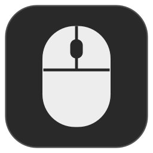

# MouseMap

A small native macOS utility for Logitech MX Master 3 shortcuts, with per-application profiles and an importer for existing Logi Options+ assignments.

MouseMap uses macOS event taps and Logitech HID++ through `IOHIDManager`. It needs no kernel extension, account, or Logitech background agent.

## Features

- Assign shortcuts to the wheel click, Back, Forward, wheel-mode, and thumb buttons.
- Set global mappings with application-specific overrides, matched by bundle identifier.
- Record keyboard shortcuts or build them with clickable modifier and key buttons.
- Map thumb-button click and directional gestures, plus thumb-wheel left/right movements.
- Navigate browser tabs once per thumb-wheel burst, with a 300 ms quiet period between turns and immediate direction reversal.
- Import compatible Options+ profiles, keyboard shortcuts, and the selected gesture preset.
- Keep native behavior for unassigned buttons or explicitly override an inherited mapping.
- Run in the menu bar with no Dock icon. Closing settings leaves remapping running; only **Quit MouseMap** exits.
- Launch at login through Apple's `SMAppService`.
- Check permissions, input capture, mouse configuration, profiles, and login registration at startup and after wake.

## Requirements

- macOS 14 or later is the build target. Runtime validation has been on an Apple silicon Mac running macOS 27.
- Xcode Command Line Tools (`xcode-select --install`).
- A Logitech MX Master 3. Bluetooth has been validated; receivers and other mouse models have not.
- Accessibility and Input Monitoring permission for MouseMap.

## Build and install

```sh
git clone https://github.com/cosmindolha/MouseMap.git
cd MouseMap
./build.sh
mkdir -p "$HOME/Applications"
ditto build/MouseMap.app "$HOME/Applications/MouseMap.app"
open "$HOME/Applications/MouseMap.app" --args --request-permissions
```

The build renders the icon, compiles the Swift application, signs it locally, and runs the regression checks. No downloaded dependencies or API keys are needed. The default signature is ad-hoc; for a stable development signature across rebuilds, select an identity already installed in your own Keychain:

```sh
MOUSEMAP_SIGNING_IDENTITY="Apple Development: Your Name (YOURTEAMID)" ./build.sh
```

This repository provides source, not a notarized distribution. Quit the running app before replacing its installed bundle. macOS may require permission approval again when the signing identity changes.

## Setup and background operation

1. If migrating from Options+, import its profiles before uninstalling it.
2. Use **Enable Accessibility** and **Enable Input Monitoring**, then approve MouseMap in System Settings. Guided setup requests Accessibility first and Input Monitoring after it is enabled.
3. Wait for **Ready**, which confirms the running GUI application's setup checks, including device configuration.
4. Select **All applications** or add an application. Click a shortcut field to open the editor. Either use **Record keyboard shortcut** or select modifier symbols and a key, then choose **Save shortcut**. Escape stops recording; **Cancel** discards the draft.
5. Enable **Open at login** if wanted.

The mouse icon in the macOS menu bar opens settings and provides Pause/Resume and Quit. The red window-close button closes settings without stopping the input engine. MouseMap stays out of the Dock, including while settings are open. No settings window is needed for profile switching or remapping.

Pause restores native reporting for diverted buttons; quitting restores temporary reporting before exiting. Login launches leave settings closed unless permission setup needs attention. It runs in the logged-in user's session; it does not remap the macOS login screen or run as root.

On wake, MouseMap discards the old HID connection, clears pre-sleep button state, and rediscovers the mouse. Bluetooth handshakes retry with bounded delays of 0.5, 1, 2, 4, and 8 seconds, and configured reporting modes are read back from the mouse before it is considered ready. Fresh physical mouse activity can restart recovery after these attempts are exhausted.

When remapping starts, MouseMap stops the current user's Options+ agent to prevent competing assignments. It does not uninstall Options+ automatically. **Restore Options+** is available while its launch agent remains installed.

## Building a shortcut

The editor offers clickable **⌃ Control**, **⌥ Option**, **⇧ Shift**, **⌘ Command**, and **fn** modifiers, plus common special keys, letters, numbers, punctuation, and F1–F20. Select several modifiers together, then one key. The preview shows both symbols and full key names. For example, previous tab can be constructed as **Control + Shift + Tab (⌃⇧⇥)**, or Safari's **Shift + Command + [**, without invoking those shortcuts while setting them up. **⇧ Shift** is a modifier; **↑ Up Arrow** is a separate key.

Keyboard recording uses a focused capture field rather than a window-wide event monitor. Mouse remapping is paused while the editor is open, and neither entry method emits the shortcut during editing. Drafts are saved only with **Save shortcut** and remain tied to the selected application profile. Some system-reserved combinations can still be intercepted by macOS before applications receive them; use the buttons for those combinations.

## Importing Options+ profiles

The importer reads the local Options+ SQLite settings database in read-only mode. Before conversion it creates a SQLite backup including the live write-ahead journal, then saves a conversion report. Existing MouseMap profiles are backed up before an import replaces them.

It translates USB keyboard usages into macOS virtual keycodes, resolves applications by bundle identifier, and imports compatible button shortcuts, thumb-wheel assignments, and selected thumb gestures. Native mouse assignments remain native. Unsupported assignments are reported rather than guessed.

Pointer speed, SmartShift, scroll-speed tuning, Flow, Smart Actions, and keyboard-device settings are outside this shortcut utility. Original settings remain in the import backup.

## Local data and privacy

Profiles and diagnostics stay in `~/Library/Application Support/MouseMap/`:

| File or directory | Contents |
| --- | --- |
| `profiles.json` | Active profiles, written atomically |
| `import-report.json` | Import results and backup location |
| `Imports/` | Original Options+ snapshot and converted profiles |
| `profiles-before-import-*.json` | Profiles saved before a replacement import |
| `runtime-health.json` | The GUI process's current permissions and setup checks |

The app contains no networking or telemetry client. It captures keyboard input locally while recording a shortcut and posts the configured shortcut when a mapped control is used. Import backups can contain personal application settings; keep them private. Local data, databases, build products, and signing material are excluded from Git.

## Architecture

| Component | Responsibility |
| --- | --- |
| `Router` | Profile selection, inheritance, native overrides, button down/up pairing |
| `EventEngine` | macOS session event tap and keyboard event posting |
| `Logitech` | Nonexclusive HID access, discovery, temporary diversion, gesture reports |
| `LogiImport` | Read-only SQLite import, backup, keycode conversion |
| `StartupHealth` | Setup readiness used by the GUI and local health report |
| `ShortcutDraft` / `ShortcutEditorView` | Shared shortcut representation for button construction and focused keyboard capture |

Logitech-specific controls use HID++ feature `0x1B04`. Only configured controls are diverted. Persistent remapping flags are not changed. Protocol references: [Logitech HID++ documentation](https://github.com/Logitech/cpg-docs/tree/master/hidpp20) and [Solaar's HID++ implementation](https://github.com/pwr-Solaar/Solaar/blob/master/lib/logitech_receiver/hidpp20.py).

## Diagnostics and tests

```sh
build/MouseMap.app/Contents/MacOS/MouseMap --self-test
build/MouseMap.app/Contents/MacOS/MouseMap --diagnose
build/MouseMap.app/Contents/MacOS/MouseMap --probe-hid
```

| Flag | Action |
| --- | --- |
| `--self-test` | Run profile, persistence, importer, report-parsing, gesture, readiness checks |
| `--diagnose` | Show permissions for that process, connected devices, login registration |
| `--probe-hid` | Discover live controls and restore native reporting before exit |
| `--test-wake-recovery` | With the GUI quit, exercise two recovery cycles on the live mouse and inject one transient failed handshake; does not put the Mac to sleep |
| `--import-options` | Snapshot and import the original local Options+ database |
| `--enable-login` | Register the installed bundle for login startup |
| `--request-permissions` | Launch the GUI with guided permission setup |
| `--background` | Launch with settings closed when permissions are already granted |

CLI permission results can inherit the terminal's authorization. Use the running application's **Ready** status or `runtime-health.json` to check the GUI itself. Avoid a HID probe while the GUI is actively remapping: the probe restores reporting modes before exiting.

Validated: native build, regression checks, continued input capture with settings closed and no Dock presence, GUI recording, imported app overrides, backup integrity, login registration, live Bluetooth discovery of six controls, and the GUI's permission/event-tap/device readiness checks. A fresh-login launch and physical shortcut behavior in every target application have not been exhaustively tested.

## Current limitations

- Horizontal wheel shortcuts also affect horizontal scrolling from other mice or trackpads in the same application.
- Ctrl-Tab and Ctrl-Shift-Tab wheel mappings fire once per event burst and ignore momentum. Other wheel shortcuts retain a 100 ms interval.
- Gestures use a 50-count dead zone and fire once on release. Options+' continuous gesture timing is not replicated.
- Manually added standard OS button mappings also apply to other mice; imported MX Master mappings use device-specific HID++ controls.
- Hardware-specific errors appear in settings. Wake the mouse and use **Reconnect mouse** when needed.
